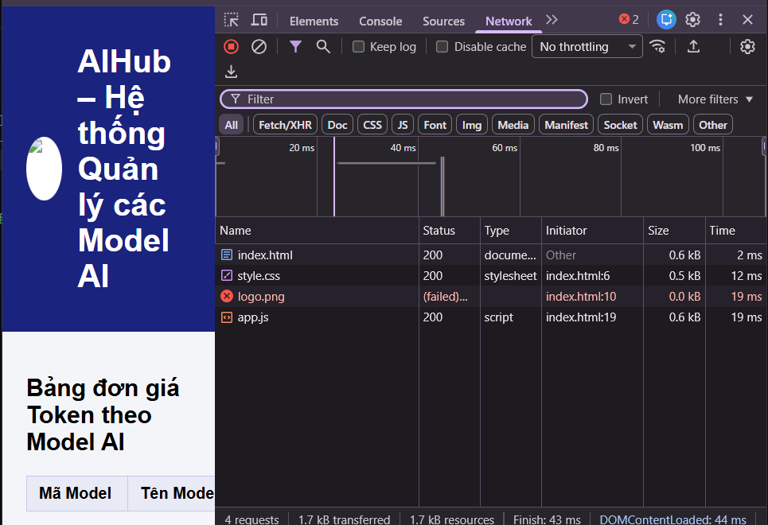
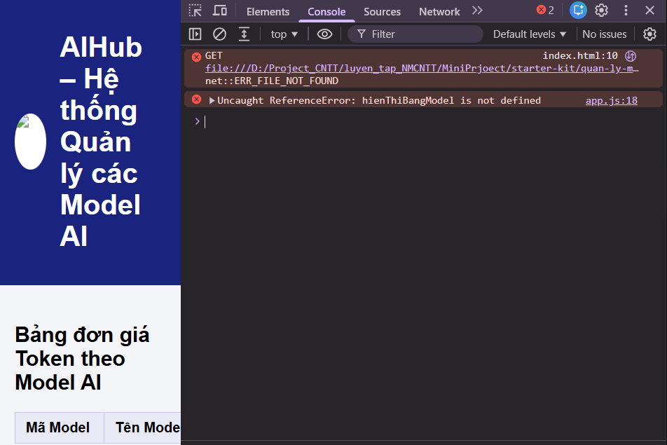

# BÀI LÀM –(CHỦ ĐỀ QUẢN LÝ MODEL AI)

- **Mã đề:*
- **Họ tên:Nguyễn Văn Mạnh Tùng**
- **Lớp:HNKS26CNTT3**
- **Link repository:**
- **Hệ điều hành (Windows/macOS):Windows**

## 4.2. Thao tác máy tính cơ bản bằng CLI

### Các lệnh đã chạy

```shell
1. pwd
2. ls -Recurse -Force
3. mv ".\tai_lieu_ban_giao.txt" ".\docs"
4. mkdir backup
5. cp ".\data\chi_phi_model_thang_11.xlsx" ".\backup"
6. rm .\model_cache_01.tmp
7. cd .\logs 
    Get-Content .\inference.log
    cd..

```

### Kết quả liệt kê toàn bộ dự án (Windows: Get-ChildItem -Recurse -Force; macOS: ls -aR)

```text
 Directory: D:\Project_CNTT\luyen_tap_NMCNTT\MiniPrjoect\starter-kit\quan-ly-model-ai


Mode                 LastWriteTime         Length Name
----                 -------------         ------ ----
d-----        11/10/2026   1:48 PM                backup
d-----        11/10/2026   1:45 PM                data
d-----        11/10/2026   1:47 PM                docs
d-----        11/10/2026   1:44 PM                evidence
d-----        11/10/2026   1:45 PM                logs
d-----        11/10/2026   1:41 PM                web
-a----        11/10/2026   1:41 PM             96 .env
-a----        11/10/2026   1:50 PM           2860 bai_lam.md


    Directory: D:\Project_CNTT\luyen_tap_NMCNTT\MiniPrjoect\starter-kit\quan-ly-model-ai\backup


Mode                 LastWriteTime         Length Name
----                 -------------         ------ ----
-a----        11/10/2026   1:41 PM           5815 chi_phi_model_thang_11.xlsx


    Directory: D:\Project_CNTT\luyen_tap_NMCNTT\MiniPrjoect\starter-kit\quan-ly-model-ai\data


Mode                 LastWriteTime         Length Name
----                 -------------         ------ ----
-a----        11/10/2026   1:41 PM           5815 chi_phi_model_thang_11.xlsx


    Directory: D:\Project_CNTT\luyen_tap_NMCNTT\MiniPrjoect\starter-kit\quan-ly-model-ai\docs


Mode                 LastWriteTime         Length Name
----                 -------------         ------ ----
-a----        11/10/2026   1:41 PM            204 tai_lieu_ban_giao.txt


    Directory: D:\Project_CNTT\luyen_tap_NMCNTT\MiniPrjoect\starter-kit\quan-ly-model-ai\logs


Mode                 LastWriteTime         Length Name
----                 -------------         ------ ----
-a----        11/10/2026   1:41 PM           1234 inference.log


    Directory: D:\Project_CNTT\luyen_tap_NMCNTT\MiniPrjoect\starter-kit\quan-ly-model-ai\web


Mode                 LastWriteTime         Length Name
----                 -------------         ------ ----
d-----        11/10/2026   1:41 PM                images
-a----        11/10/2026   1:41 PM            644 app.js
-a----        11/10/2026   1:41 PM            567 index.html
-a----        11/10/2026   1:41 PM            460 style.css


    Directory: D:\Project_CNTT\luyen_tap_NMCNTT\MiniPrjoect\starter-kit\quan-ly-model-ai\web\images


Mode                 LastWriteTime         Length Name
----                 -------------         ------ ----
-a----        11/10/2026   1:41 PM            339 logo-ai-hub.png

```

## 4.3. Lọc log vận hành Model AI

### a) Lệnh lọc các dòng ERROR

```shell
".\logs\inference.log" | Select-String "error" >> ".\logs\loi_model.txt"

```

### 2 dòng đầu tiên trong logs/loi_model.txt

```text
2026-11-10 08:27:45 ERROR POST /v1/chat/completions model=CLAUDE-35
2026-11-10 08:31:12 ERROR POST /v1/audio/transcriptions model=WHISPER-V3


```

### b) Lệnh đếm số dòng WARNING và kết quả

```shell
(Get-Content ".\logs\inference.log" | Select-String "warning").count

```

```text
5

```

## 4.4. Chạy script tong_hop (.ps1 hoặc .sh)

### Lệnh chạy (Windows: nếu dùng Phụ lục 2 thì ghi cả 2 lệnh)

```shell
Set-ExecutionPolicy -Scope Process -ExecutionPolicy Bypass
.\tong_hop.ps1
```

### Nội dung file logs/tong_hop.txt

```text
=== BAO CAO VAN HANH MODEL AI ===

2026-11-10 08:09:18 WARNING POST /v1/embeddings model=LLAMA-2-OLD
2026-11-10 08:16:05 WARNING GET /v1/fine-tune/jobs-legacy
2026-11-10 08:38:29 WARNING GET /images/model-card-v1.png
2026-11-10 09:01:44 WARNING POST /v1/completions model=DAVINCI-002
2026-11-10 09:14:02 WARNING GET /v1/quota/expired-key


Count    : 6
Average  : 
Sum      : 
Maximum  : 
Minimum  : 
Property : 


```

## 4.5. README.md và bảo vệ thông tin bí mật

> README.md, .gitignore và .env.example được chấm trực tiếp trên file ở gốc dự án. Đánh dấu `[x]` vào các mục đã làm để tự kiểm tra.

- [ ] README.md: Heading 1, hình ảnh (``), mô tả có **in đậm**, _in nghiêng_ và `inline code`, bảng, code block, task list, blockquote
- [ ] .gitignore có dòng `.env` (tên file đúng, không có đuôi .txt)
- [ ] .env.example có đủ tên biến, giá trị để trống (tên file đúng, không có đuôi .txt)

## 4.6. Kiểm tra trang web bằng DevTools (F12) và báo cáo lỗi

### Bảng lỗi

| STT | Tab DevTools phát hiện lỗi | Tên file hoặc thông báo lỗi | Cách khắc phục |
| --- | -------------------------- | --------------------------- | -------------- |
| 1   |    Network                        |           Bị sai tên ảnh                  |  Sửa lại tên ảnh cho đúng              |
| 2   |    Console                        |          hienThiBangModel is not defined                   |       Bị sai tên ở dòng 18 và sửa hienThiBangModel thành hienThiBangModelAI         |

> Ảnh chụp màn hình lưu trong thư mục `evidence/` (network.png, console.png).


### Báo cáo lỗi gửi trưởng nhóm

- **Context:Hiện tại web quản lý hệ thống model Ai của tôi đang bị lỗi không hiển thị bảng**
- **Expected:Tôi muốn hiển thị ra bảng tính**
- **Actual:Nhưng hiện tại đang bị lỗi và không hiện ra bảng và lỗi ở web console**
- **Log:hienThiBangModel is not defined**

### Câu tìm kiếm Google

```text
site:stackoverflow.com "is not defined"

```

## 4.7. Excel

> Phần Excel được chấm trực tiếp trên file `data/chi_phi_model_thang_11.xlsx`, không cần ghi vào đây.
